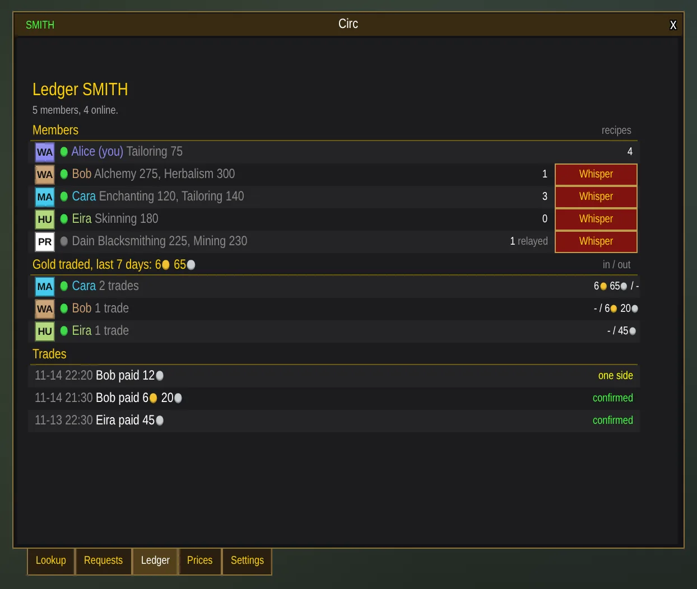

# Circ

A trade ledger for your guild, friends or realm, in World of Warcraft. **For WoW Classic Era
(1.15).** Circ shares what each member crafts, buys and sells, so the gold you would have
spent at the Auction House or a vendor stays with people you know.

Website: [latentrune.github.io/circ](https://latentrune.github.io/circ/) · Guide:
[latentrune.github.io/circ/docs.html](https://latentrune.github.io/circ/docs.html)

## What it shows

- **Lookup:** type an item or shift-click it in your bags, and see who in your ledger buys
  it, who makes it, and who has it in their bags, with their prices. Or look up a member
  to see everything they make, sell, buy and request.
- **Requests:** post what you want to buy, see what others want, and request the
  materials your recipes use in one click.
- **Prices:** what you charge for your crafts and pay for materials. With Auctionator,
  TSM or Aux installed, Circ suggests prices; leave any blank and buyers whisper you.
  Shift-click an item in your bags to sell it, like BoE gear or spare materials.
- **Ledger:** who is in your ledger and online, the gold you traded with each member over
  the last week, and every trade, confirmed once both sides reported it.
- **Reminders** when you're about to vendor or auction something a member pays more for,
  and ledger lines on every item tooltip.

Every part has a checkbox on the Settings tab.

## Install

1. Download the latest `Circ-<version>.zip` from
   [Releases](https://github.com/LatentRune/circ/releases).
2. Unzip it into `World of Warcraft/_classic_era_/Interface/AddOns/`, so you have
   `.../AddOns/Circ/Circ.toc`.
3. Restart the game, or `/reload`.

That's all. Circ opens by itself the first time, with a getting-started bar that shows one
step at a time. You start in the ledger START with everyone else who has Circ; to make
your own ledger and invite friends, turn on Ledger management under Settings > Advanced.

## Commands

| Command | What it does |
|---|---|
| `/circ` | Open or close the window |
| `/circ find <item>` | Look up an item |
| `/circ request <item> <qty> <price>` | Post a request to buy; `/circ unrequest <item>` takes it down |
| `/circ buy <item> <price\|off\|auto>` | What you pay for a material |
| `/circ sell <item> <price\|off\|auto>` | What you charge for a craft |
| `/circ shop <item> [qty]` | Shopping list: who makes it, and where to get its materials |
| `/circ pct <n>` / `/circ margin <n>` | How suggested prices are worked out |
| `/circ create <NAME>` | Start a ledger with a 5-letter name (needs Ledger management) |
| `/circ invite <player>` | Invite a player to your ledger (needs Ledger management) |
| `/circ leave` | Leave your ledger and go back to START (needs Ledger management) |
| `/circ reconnect` | Reconnect to your ledger's channel |
| `/circ nudges`, `tooltip`, `minimap` `on\|off` | Turn the reminders, tooltip lines or minimap button on or off |
| `/circ help` | List every command |

Prices can be written `1g20s`, `35s`, `80c` or `1.5` (gold).

## Known limits

- Circ can take up to two minutes after login to reach the ledger's channel. It keeps
  trying by itself, and again whenever you click in Circ; the Ledger tab has a Connect
  button meanwhile.
- Every Classic Era recipe comes with Circ, so lookups work before anyone scans, but each
  member still opens their profession windows once so the ledger knows who makes what.
- The bundled item and recipe names are English. Other languages work with your own
  scans; a crafter's skill level may be blank.
- The ledger's channel is hidden in Circ but still shows in the game's own channel list.

## Feedback and contributing

Circ is built with its players. Tell us what works and what doesn't:

- [Report a bug](https://github.com/LatentRune/circ/issues/new?template=bug.yml)
- [Say how something looks](https://github.com/LatentRune/circ/issues/new?template=looks.yml)
- [Suggest an idea](https://github.com/LatentRune/circ/issues/new?template=idea.yml)

Questions and quick feedback go to [Discord](https://discord.gg/wcCfAmMsFV). Longer
conversations about where Circ should go live in
[Discussions](https://github.com/LatentRune/circ/discussions); everything filed so far is
under [Issues](https://github.com/LatentRune/circ/issues).

Want to change something yourself? You don't need the game running to see your change:
the screenshot tools draw Circ from its real code and put before-and-after pictures in
your pull request. Start with [CONTRIBUTING.md](CONTRIBUTING.md). If you use an AI coding
assistant, [prompts/](prompts/) has prompts ready to paste.

## Support Circ

Circ is free. If it helps you, you can
[leave a tip on Ko-fi](https://ko-fi.com/latentrune) or
[support it monthly](https://buy.stripe.com/00wdR93RAdvsdxwaPwew801).

## TODO: community

Getting Circ in front of players and building a community around it.

- [x] Donations: Ko-fi and a Stripe monthly link, both on the repo's Sponsor button
      through `.github/FUNDING.yml`
- [ ] GitHub Sponsors, once the account is approved (add `github: [LatentRune]` to
      `.github/FUNDING.yml` and a button to `docs/index.html`)
- [ ] Listings on CurseForge and Wago, fed from GitHub releases
- [x] A Discord server for quick feedback, and GitHub Discussions for ideas worth keeping
- [ ] Turn on GitHub Pages (from `docs/`) for the landing page and `docs.html`, and set it
      as the repo's website
- [ ] Upload `docs/images/social.jpg` as the repo's social preview
- [ ] Turn on Discussions, and create the `looks` and `good first issue` labels
- [ ] Label 5 to 10 small look tweaks as `good first issue`
- [ ] WoW Forever support (its own `## Interface:` line and an API check)

## License

[MIT](LICENSE).
